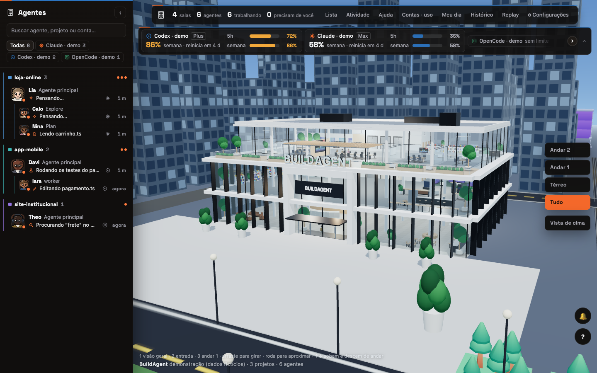
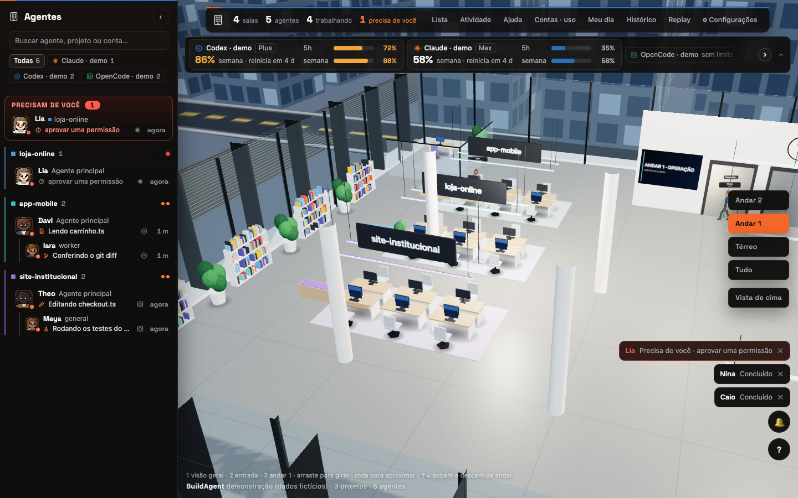
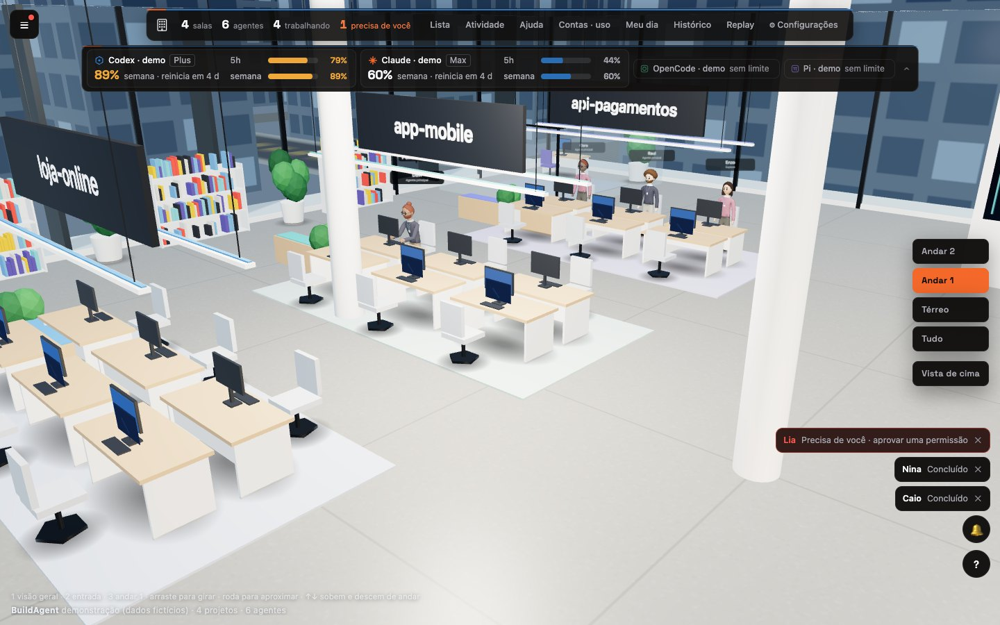
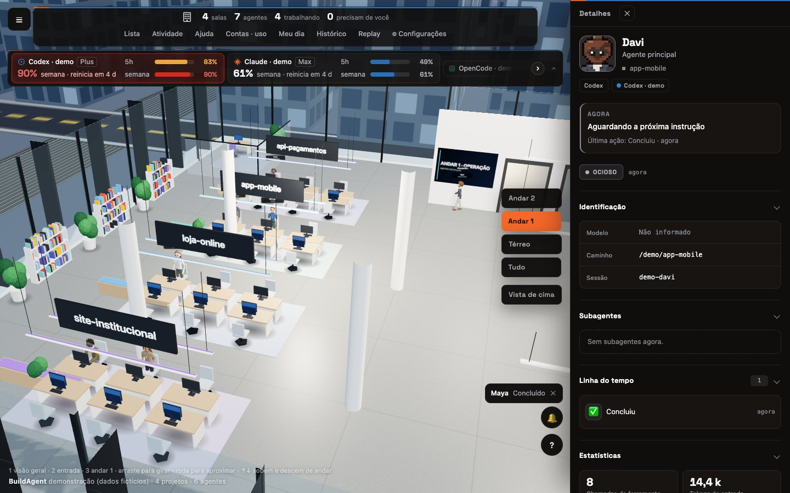
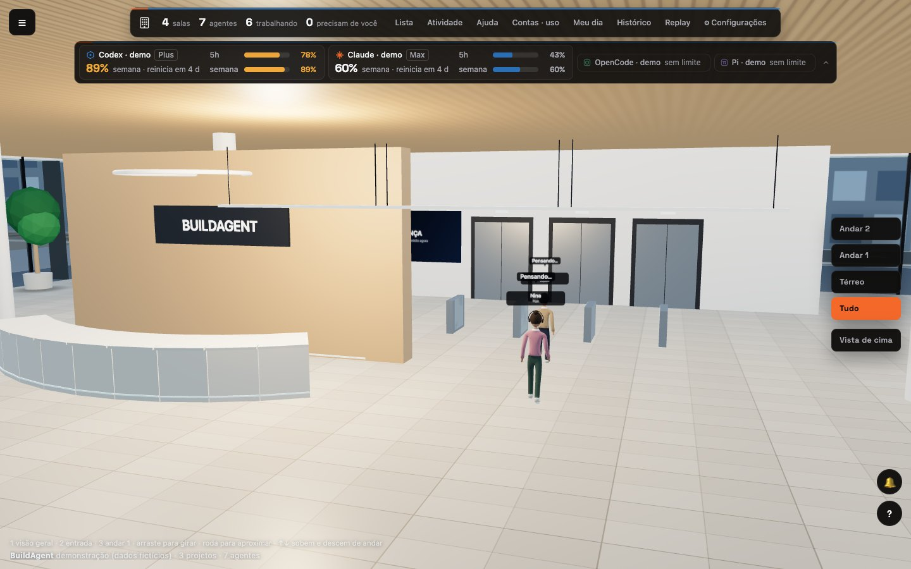
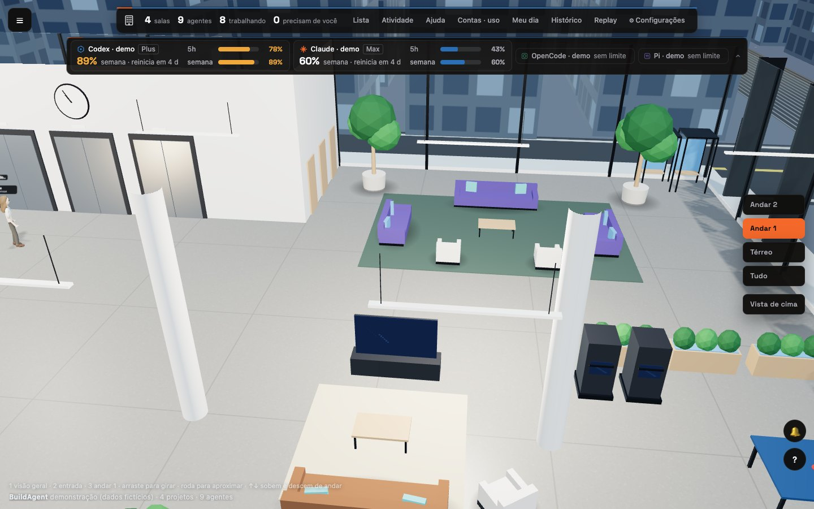
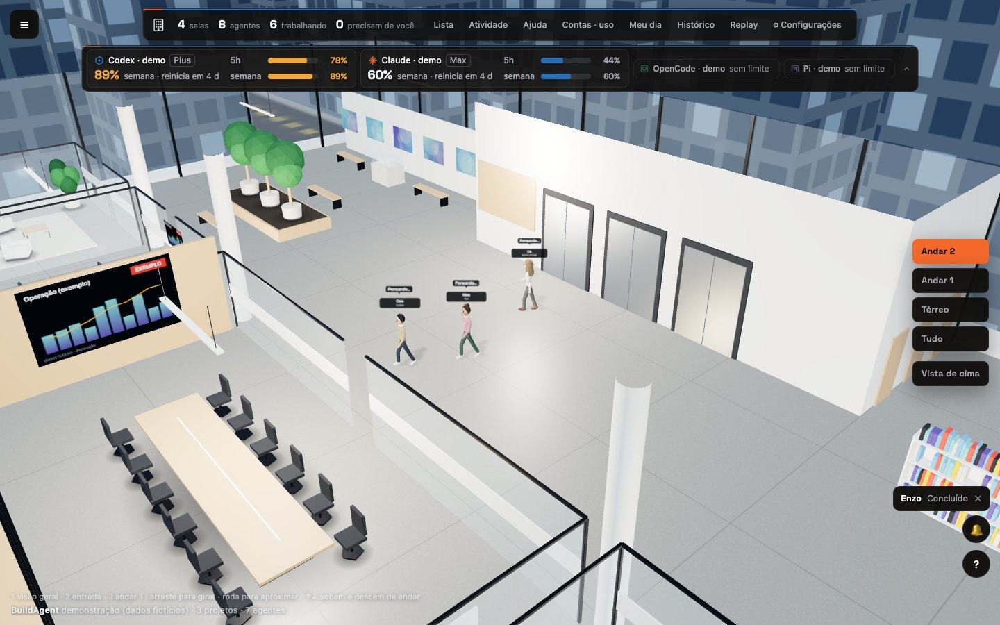
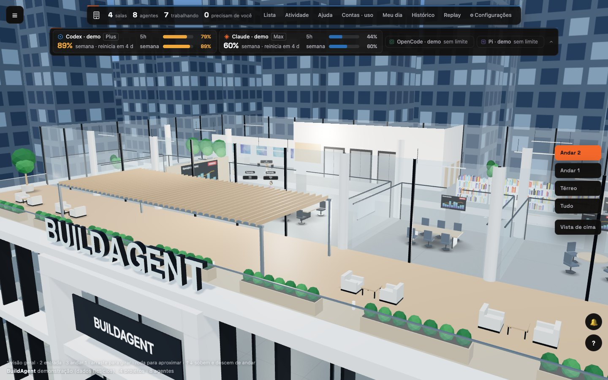

# BuildAgent

**A 3D building that shows, in real time, what your AI agents are doing.**
Each agent becomes a person: walks in through the door, takes the elevator, sits at the project's desk,
works, asks for your attention when it needs you, and leaves when it is done.

[Português](README.md) · [Architecture (pt-BR)](docs/ARQUITETURA.md) · [Contributing](CONTRIBUTING.md) · [Security](SECURITY.md)

https://github.com/user-attachments/assets/e40f6f36-7f75-4eea-8f9f-f6cdb1f28b4a




## Inside the building

<table>
<tr>
<td width="50%"><br><sub>Work floor up close: whoever is working sits at the project row</sub></td>
<td width="50%"><br><sub>Agent detail: what it is doing now, subagents and timeline</sub></td>
</tr>
<tr>
<td width="50%"><br><sub>Ground floor: arrivals pass the reception and the turnstiles, then take the elevator</sub></td>
<td width="50%"><br><sub>Lounge on the work floor</sub></td>
</tr>
<tr>
<td width="50%"><br><sub>Floor 2: meeting room and gallery</sub></td>
<td width="50%"><br><sub>Rooftop from outside, with the sign</sub></td>
</tr>
</table>

The images and the video come from demo mode (fictional agents).

## What it reads

BuildAgent **only reads** files that the tools already write on your computer. It sends nothing out,
asks for no API key, and never writes into agent folders.

| Tool | Source | Turn off |
|---|---|---|
| Claude Code | `~/.claude` (and other account folders) | — |
| Codex | `~/.codex` | `BUILDAGENT_CODEX=0` |
| OpenCode | local OpenCode database | `BUILDAGENT_OPENCODE=0` |
| Pi | `~/.pi/agent/sessions` | `BUILDAGENT_PI=0` |
| OpenBot | local registry (agent name, role and folder only) | `BUILDAGENT_OPENBOT=0` |

Conversation text is not copied to the screen: each speech bubble shows the state and the kind of
activity ("editing", "running tests"). The panels show project name, folder and the session title (usually
the start of your request); the local API also carries the command and file in use, with secrets masked.
Details in [SECURITY.md](SECURITY.md).

## Getting started

Requires **Node.js 22.13 or newer** (the project uses Node's built-in SQLite).

```bash
git clone https://github.com/AgGreatMinds/buildagent.git
```

```bash
cd buildagent && npm install
```

```bash
npm run build && npm start
```

Open `http://127.0.0.1:4750`. A single port serves both the interface and the data.

### Install with your AI agent (already with your brand)

If you use Claude Code, Codex or another agent that runs commands on your computer, paste the text below.
It installs, asks how you want the building, and starts everything:

```text
Install BuildAgent on my computer and brand it as mine.

1. Check that Node.js is 22.13 or newer (node -v). If it is not, stop and tell me.
2. Clone https://github.com/AgGreatMinds/buildagent.git and run "npm install" inside the folder.
3. Before customizing, ask me, one thing at a time:
   - the name for the sign on the facade (up to 20 characters; accents are removed);
   - whether I have an SVG logo (ask for the file path): it goes embossed on the facade and at reception;
   - whether I have an SVG symbol for the corner of the panel;
   - the port (default 4750);
   - which of these tools to turn off: Codex, OpenCode, Pi, OpenBot (Claude Code is always on).
4. Create the folder client/public/local/ and write into it:
   - predio.json with { "nome": "THE NAME I CHOSE" };
   - logo.svg and simbolo.svg, if I gave you the files.
5. If the port or the tools differ from the defaults, copy .env.example to .env and change only
   BUILDAGENT_PORT and, to turn a tool off, BUILDAGENT_CODEX=0, BUILDAGENT_OPENCODE=0,
   BUILDAGENT_PI=0 or BUILDAGENT_OPENBOT=0. Do not change BUILDAGENT_HOST. For English, also set
   BUILDAGENT_LANG=en and tell me to pick EN under Settings.
6. Run "npm run build" and then "npm run demo", and give me the address (http://127.0.0.1:PORT)
   so I can see the building with fictional agents.
7. When I approve, stop the demo and run "npm start" to show my real agents.

Rules: do not read or copy the content of my conversations, do not touch anything outside the
project folder, and do not expose the panel on the network.
```

### Just show me

```bash
npm run build && npm run demo
```

Demo mode uses fictional agents and **reads no real session** — good for testing, recording a video or
showing the project without exposing what you are working on.

### Development

Two terminals: the server (`npm run dev`, port 4750) and the interface with hot reload
(`npm run dev:client`, port 5750). `npm test` and `npm run typecheck` must pass.

## Controls

| Key | Action |
|---|---|
| `1` | Building overview |
| `2` | Entrance |
| `3` | Work floor (desks per project) |
| `4` | City |
| `5` | Ground floor (reception and elevators) |
| `6` | Work floor, lounge side |
| `7` / `8` | Rooftop, outside and inside |
| `↑` `↓` | Floor up / down |
| `d` | Slow orbit camera |
| drag / wheel | Rotate and zoom (zoom goes where the cursor points) |

Click a person (or the list on the left) to open the agent's details. Double-click follows the person.

## Light by design

- Hidden tab: nothing is drawn.
- Nobody in view: about one frame per second; people walking: 30.
- Zoomed into the building, the city stops: cars and lights only animate with the camera far away.
- Quality adapts to the machine (shadows, resolution, monitor screens).

Add `?perf=1` to the address to see frames per second, draw calls and the current level.

## Configuration

All through environment variables, none required. See the table in the [Portuguese README](README.md#configurar)
and the template in [`.env.example`](.env.example): export the variables in your shell, or copy the template
to `.env` at the project root — `npm start`, `npm run demo` and `npm run dev` load it automatically.

**`BUILDAGENT_HOST` other than `127.0.0.1` exposes the panel on your local network with no password.**

## Live account usage (optional)

The "Accounts · usage" strip shows what Claude Code already cached (it refreshes when you run `/usage`).
To have the numbers follow the session, set `scripts/statusline-uso.mjs` as Claude Code's statusline in
`~/.claude/settings.json`:

```json
{ "statusLine": { "type": "command", "command": "node /path/to/buildagent/scripts/statusline-uso.mjs" } }
```

It only writes the usage percentage to `~/.buildagent/usage/` — no credentials, no network. If you already have
a statusline, put its command in `~/.buildagent/statusline-original.txt`: the script runs it afterwards, so your
bar stays the same.

## Make it yours

Create `client/public/local/` (kept out of git) with:

- `predio.json` — `{ "nome": "MY COMPANY" }` changes the sign on the façade (up to 20 characters; accents are removed).
- `logo.svg` — becomes the embossed logo on the façade and in the reception.
- `simbolo.svg` — replaces the panel glyph (top bar and list header) with your own mark.
- `fonts/GeneralSans-Variable.woff2` — optional: the panel's body font. It is not in the repository (its license
  does not allow redistribution); get it at [fontshare.com](https://www.fontshare.com/fonts/general-sans). Without
  it, the panel uses the system font.

Then run `npm run build` again.

## Known limits

- People walk along fixed corridors and step aside when crossing each other, but there is no free-route
  obstacle avoidance: an occasional bump can still happen at rush hour.
- The OpenBot registry is read from the default macOS path; elsewhere, set `BUILDAGENT_OPENBOT_DB`.
- The interface, code comments and most documentation are in Brazilian Portuguese.

## Credits and license

MIT — see [LICENSE](LICENSE). Part of the server was ported from
[Habblaud](https://github.com/marmottajr/habblaud) (MIT); credits and the file list are in
[NOTICE.md](NOTICE.md) and [LICENSE-HABBLAUD](LICENSE-HABBLAUD). Third-party 3D models and fonts are listed
there too.
