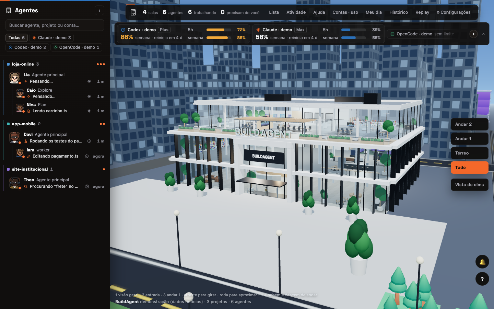
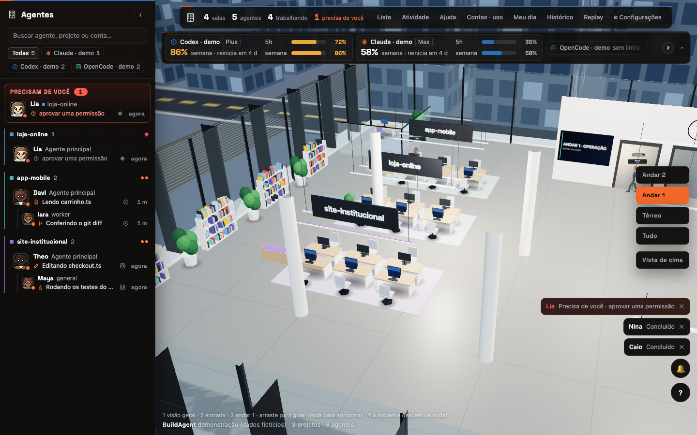

# BuildAgent

**Um prédio 3D que mostra, em tempo real, o que os seus agentes de IA estão fazendo.**
Cada agente vira uma pessoa: entra pela porta, sobe de elevador, senta na mesa do projeto, trabalha,
pede a sua atenção quando precisa de você e vai embora quando termina.

[English](README.en.md) · [Arquitetura](docs/ARQUITETURA.md) · [Como contribuir](CONTRIBUTING.md) · [Segurança](SECURITY.md)




## O que ele lê

O BuildAgent **só lê** arquivos que as ferramentas já gravam no seu computador. Não envia nada para fora,
não pede chave de API e não escreve nas pastas dos agentes.

| Ferramenta | De onde vem | Desligar |
|---|---|---|
| Claude Code | `~/.claude` (e outras pastas de conta) | — |
| Codex | `~/.codex` | `HABBLAUD_CODEX=0` |
| OpenCode | banco local do OpenCode | `HABBLAUD_OPENCODE=0` |
| Pi | `~/.pi/agent/sessions` | `HABBLAUD_PI=0` |
| OpenBot | cadastro local (só nome, cargo e pasta do agente) | `HABBLAUD_OPENBOT=0` |

O texto das conversas não é copiado para a tela: o balão de cada pessoa mostra o estado e o tipo de
atividade ("editando", "rodando teste"). Os painéis mostram nome do projeto, pasta e o título da sessão
(que costuma ser o começo do seu pedido); a API local também carrega o comando e o arquivo em uso, com
segredos mascarados. Detalhe em [SECURITY.md](SECURITY.md).

## Começar

Requer **Node.js 22.13 ou mais novo** (o projeto usa o SQLite embutido do Node).

```bash
git clone https://github.com/AgGreatMinds/buildagent.git
```

```bash
cd buildagent && npm install
```

```bash
npm run build && npm start
```

Abra `http://127.0.0.1:4750`. Uma porta só serve a interface e os dados.

### Só quero ver funcionando

```bash
npm run build && npm run demo
```

O modo demonstração usa agentes fictícios e **não lê nenhuma sessão real** — serve para testar, gravar
vídeo ou mostrar o projeto sem expor o que você está fazendo.

### Desenvolvimento

Dois terminais: o servidor (`npm run dev`, porta 4750) e a interface com recarga automática
(`npm run dev:client`, porta 5750).

```bash
npm test
```

```bash
npm run typecheck
```

## Usar

| Tecla | O que faz |
|---|---|
| `1` | Visão geral do prédio |
| `2` | Entrada |
| `3` | Andar de trabalho (mesas por projeto) |
| `4` | Cidade |
| `5` | Térreo (recepção e elevadores) |
| `6` | Andar de trabalho, lado do descanso |
| `7` / `8` | Cobertura, por fora e por dentro |
| `↑` `↓` | Sobe e desce de andar |
| `d` | Câmera em órbita lenta |
| arrastar / roda | Girar e aproximar (o zoom vai para onde o cursor aponta) |

Clique numa pessoa (ou na lista à esquerda) para abrir o detalhe do agente. Duplo clique segue a pessoa.

## Leve por desenho

- Com a aba oculta, não desenha nada.
- Sem ninguém à vista, cai para cerca de um quadro por segundo; com gente andando, 30.
- Com zoom no prédio, a cidade para: carros e luzes só animam com a câmera longe.
- A qualidade se ajusta sozinha à máquina (sombras, resolução, telas dos monitores).

Acrescente `?perf=1` ao endereço para ver quadros por segundo, chamadas de desenho e o nível atual.

## Configurar

Tudo por variável de ambiente; nenhuma é obrigatória. Exporte no terminal ou copie
[`.env.example`](.env.example) para `.env` na raiz — `npm start`, `npm run demo` e `npm run dev` leem esse
arquivo sozinhos. (O prefixo `HABBLAUD_` vem do projeto de origem —
ver [NOTICE.md](NOTICE.md).)

| Variável | Padrão | Para que serve |
|---|---|---|
| `HABBLAUD_PORT` | `4750` | Porta do servidor |
| `HABBLAUD_HOST` | `127.0.0.1` | Endereço de escuta. **Qualquer valor fora de `127.0.0.1` expõe o painel na rede local, sem senha** — o servidor avisa ao iniciar |
| `HABBLAUD_ALLOWED_HOSTS` | vazio | Nomes extras aceitos no endereço (separados por vírgula). `localhost` e IPs sempre valem; abrir por outro nome sem listá-lo aqui dá erro 421 |
| `HABBLAUD_DATA_DIR` | `~/.habblaud` | Onde ficam as estatísticas do dia e a linha do tempo (única pasta em que o BuildAgent escreve) |
| `HABBLAUD_DEMO` | desligado | `1` liga o modo demonstração (igual a `--demo`) |
| `HABBLAUD_CLAUDE_DIRS` | `~/.claude` | Pastas de conta do Claude Code, separadas por vírgula |
| `HABBLAUD_CODEX` / `HABBLAUD_CODEX_DIRS` | ligado / `~/.codex` | Fonte Codex |
| `HABBLAUD_OPENCODE` / `HABBLAUD_OPENCODE_DB` | ligado / banco padrão | Fonte OpenCode |
| `HABBLAUD_PI` / `HABBLAUD_PI_DIR` | ligado / `~/.pi/agent/sessions` | Fonte Pi |
| `HABBLAUD_OPENBOT` / `HABBLAUD_OPENBOT_DB` | ligado / banco padrão do app | Cadastro do OpenBot |
| `HABBLAUD_TIMELINE` | ligado | `0` não grava a linha do tempo usada no replay |
| `HABBLAUD_LANG` | português | `en` põe os textos do servidor em inglês |

## Uso das contas ao vivo (opcional)

A faixa "Contas · uso" mostra o que o Claude Code já deixou em cache (atualiza quando você roda `/usage`).
Para o número acompanhar a sessão, ligue o script `scripts/statusline-uso.mjs` como statusline do Claude Code,
em `~/.claude/settings.json`:

```json
{ "statusLine": { "type": "command", "command": "node /caminho/para/buildagent/scripts/statusline-uso.mjs" } }
```

Ele só grava o percentual de uso em `~/.habblaud/usage/` — não lê credenciais nem usa rede. Se você já tem
uma statusline, ponha o comando dela em `~/.habblaud/statusline-original.txt`: o script a executa em seguida
e a sua barra continua igual.

## Deixar com a sua cara

Crie a pasta `client/public/local/` (ela fica fora do git) e ponha:

- `predio.json` — `{ "nome": "MINHA EMPRESA" }` troca o letreiro da fachada (até 20 letras, sem acento).
- `logo.svg` — vira a logo em relevo na fachada e na recepção.
- `simbolo.svg` — troca o glifo do painel (canto da barra e da lista) pela sua marca.
- `fonts/GeneralSans-Variable.woff2` — opcional: fonte do corpo do painel. Não vem no repositório (a licença
  dela não deixa redistribuir); baixe em [fontshare.com](https://www.fontshare.com/fonts/general-sans). Sem ela, o
  painel usa a fonte do sistema.

Depois rode `npm run build` de novo.

## Estrutura

```
client/   interface (Three.js + TypeScript): prédio, pessoas, painéis
server/   servidor somente leitura (Node + TypeScript): fontes, modelo, HTTP
shared/   tipos usados pelos dois lados
assets-src/  fontes dos modelos 3D (scripts do Blender que geram os .glb)
docs/     arquitetura e imagens
```

## Limites conhecidos

- As pessoas andam por corredores fixos e desviam umas das outras ao se cruzar, mas não há desvio de
  móveis em rota livre: em horário cheio ainda pode haver um esbarrão.
- O cadastro do OpenBot é lido do caminho padrão do macOS; em outros sistemas, aponte `HABBLAUD_OPENBOT_DB`.
- Testado no Chrome e no Safari recentes, com WebGL 2.

## Créditos e licença

MIT — ver [LICENSE](LICENSE). Parte do servidor foi portada do projeto
[Habblaud](https://github.com/marmottajr/habblaud) (MIT); os créditos e a lista de arquivos estão em
[NOTICE.md](NOTICE.md) e [LICENSE-HABBLAUD](LICENSE-HABBLAUD). Modelos 3D e fontes de terceiros também estão
no NOTICE.
